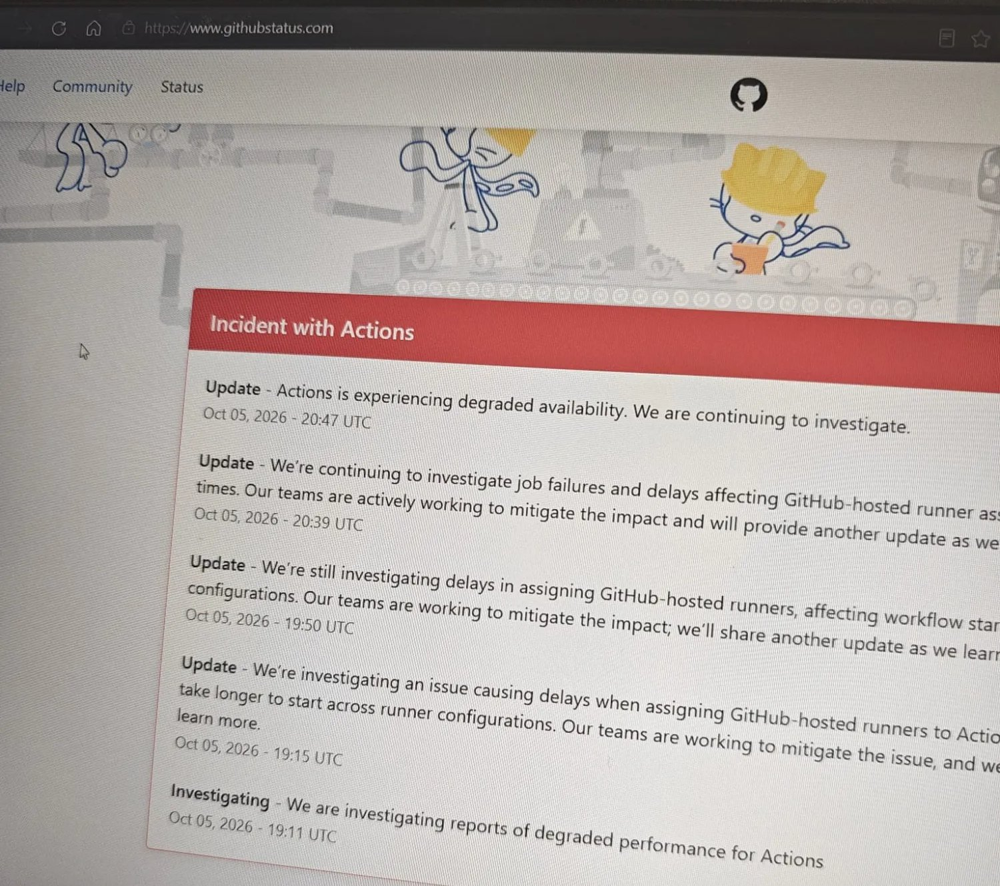
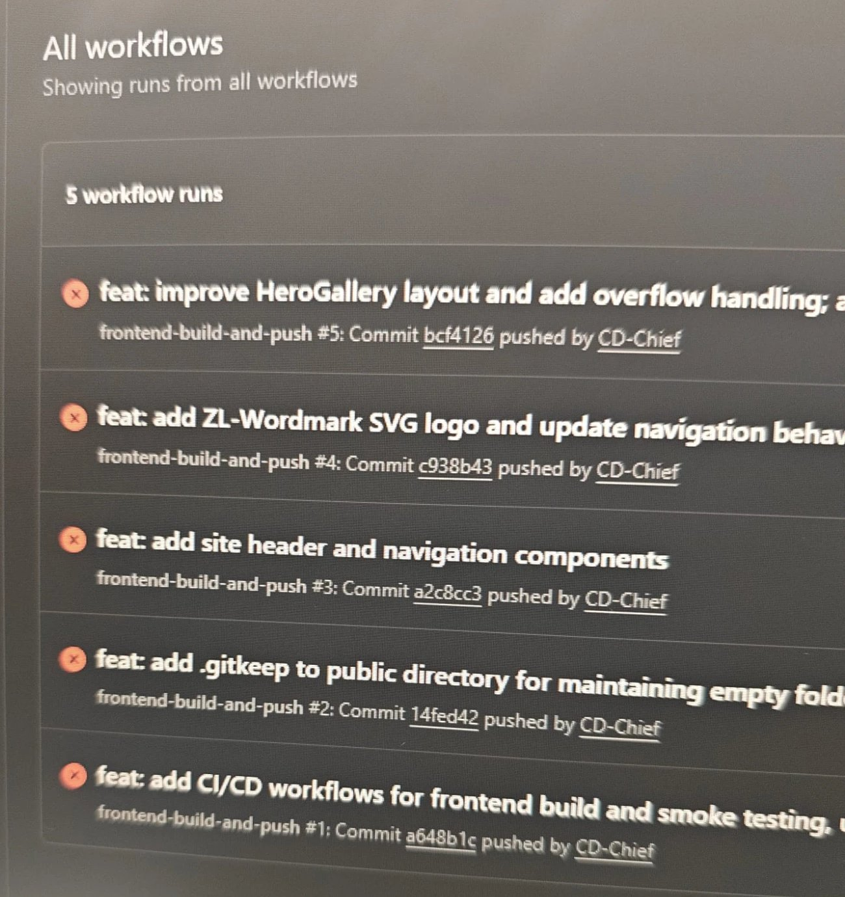

# A Year of Building My CI/CD Pipeline

About a year ago this site ran on a Raspberry Pi on my desk. Today every site I look after goes through a pipeline that tests it, builds it, deploys it and checks it's healthy, all from a `git push`.

None of that was planned. Every piece was added because something annoyed me or broke. So this post is a look at how it grew, and how it works now.

## Where it started (November 2025)

The first "deploy" was a bash script on the Pi:

```bash
npx astro build
npx astro preview --host &
cloudflared tunnel run astro-tunnel &
```

Build the site, start the preview server, open a Cloudflare tunnel so the internet can reach it. To update the site I SSH'd in, pulled, and ran it again.

It worked, mostly. If the Pi rebooted, the site was down until I noticed. There were no tests. And `astro preview` is not meant for production, which I knew and ignored.

## Moving to Docker (March to May 2026)

When I moved to a VPS with Coolify I wrote a Dockerfile, and later added a GitHub Actions workflow to build it on every push. That was the first time a push did something on its own.

It was also when the server started crashing. Coolify was building the images on the same small VPS that was serving my sites, and a build would eat the whole CPU. I wrote about that in [Offloading Docker Builds with GHCR](/blog/offloading-docker-builds): the fix was building in GitHub Actions, pushing the image to GHCR, and letting the server just pull it. Deploys went from about a minute and a half to around 10 seconds.

## Guarding the door (October 2026)

Up to here, anything I pushed went live. So the next things were about stopping bad code before it got anywhere:

- **Pull request smoke tests.** Every PR builds the site, builds the Docker image, starts the container and checks the important routes return what they should. If any of that fails, it can't be merged.
- **A real health check.** A `/api/health` route, checked by Docker inside the container. (The first version passed while not actually running at all, see [My Health Check Passed. It Shouldn't Have.](/blog/false-positive-health-checks))
- **Two image tags per build.** A moving one like `main`, and a fixed one like `main-3fa2c1d`. The fixed one is my rollback target.
- **Staging.** `dev` deploys to a locked staging copy, `main` to production. More on that in [Write Code, Push](/blog/staging-and-autodeploy).

## Browser tests (November 2026)

Then a client's iPhone showed me that a site can pass every check I had and still be broken for real people. So the restaurant site now runs Playwright tests in WebKit and Chromium on every push ([the full story](/blog/safari-videos-and-playwright)).

## So how do client sites stay online?

When people hear "push to main deploys production" they sometimes assume that's risky. Here's what actually has to go right before a change reaches a visitor:

1. **The PR smoke test passes.** The code builds, the image builds, the container starts and the routes answer.
2. **The image builds again in CI** and lands in GHCR with its fixed tag.
3. **Coolify starts the new container next to the old one.** The old one keeps serving traffic.
4. **The health check has to pass.** Only then does traffic switch to the new container. If it never goes healthy, the deploy fails and the previous version just keeps running.

That last step is the one that matters most. A bad deploy usually means "the deploy failed", not "the site is down".

## Everything runs through GitHub

My code, my builds, my image registry and my deploy trigger are all GitHub. I found out how much that matters on the evening of 5 October, when my runs started failing and taking ages. These were the first runs of a brand new workflow, so of course I assumed I'd broken it. I spent far too long going through my own setup before I checked GitHub's status page, which was already posting about an incident with Actions: delays assigning hosted runners, and job failures.


*GitHub's status page that evening.*


*Every run of the new workflow had failed. The workflow was fine.*

I'd never been hit by an outage before, and until then GitHub felt like the one thing that was always just there.

The sites stayed up, because serving a website doesn't need GitHub once the image is on the server. Coolify keeps running the containers it already has. An outage stops me shipping, not my clients' sites running. Next time I'll check the status page before I start tearing my own pipeline apart.

I haven't built a fallback, like a second registry or building locally and pushing by hand. For a handful of sites it's cheaper to wait out an outage than to maintain a second pipeline. But I think about it.

## Being honest about the gaps

It's not perfect, and I think it's worth saying where:

- **Rollback isn't automatic.** If a change is healthy but *wrong* (the page loads but something on it is broken), nothing rolls it back for me. I point Coolify at the last good `main-<sha>` image by hand, then fix forward. It's documented, but it's manual.
- **The browser tests don't block deploys yet.** They show up as a red check, but they run separately from the deploy. I want them to have a few weeks of not being flaky before I let them stop a release.
- **No lint step on this site yet.** It's literally commented out in the workflow waiting for me.

## What's next

The thing that bugged me most was that every repo had its own copy of a Coolify token in its GitHub secrets. Eight repos, eight copies of the same key. So I built something to sit in front of Coolify, and now repos deploy through it without holding any token. That one gets its own post.
