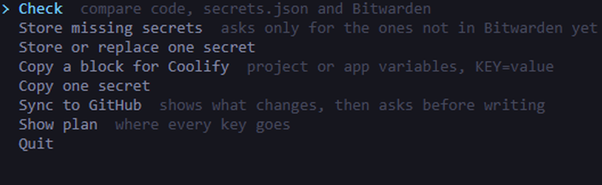

# Handling Secrets Is Really Annoying, So I Built a Tool for It

Managing keys is really annoying. So I spent a couple of hours making it better.

Managing a few keys is fine. But it started to get really tedious once I was managing different sets of keys for 5 websites, each with a separate set for staging and production, where some keys are needed at build time and some at runtime. Some of them live in GitHub, some in Coolify, some in both.

The way I was doing it before was: find the key in my password manager, copy it, paste it into the right box, hope it was the right box, repeat over and over. Then a week later, wonder if staging and production actually have the same set.

## What I built

It's a small command line tool, called `keys`, and it's built around three things:

1. **Bitwarden** stores the actual secret values. One folder per client.
2. A **`secrets.json` file in each repo** says which keys the project needs and where each one goes. It only has names, never values, so it's safe to commit.
3. The **CLI** reads both and does the boring part for me.

So the `secrets.json` is basically a map. This key is a GitHub secret, this one is a Coolify variable shared by the whole project, this one belongs only to the production app, and this public one is baked in at build time.

## How I use it

Run `keys` with no arguments and you get a menu:



Everything in the menu is also a command. In any repo I run `keys set <client>` and it asks me for every secret that isn't stored yet. I paste the value, nothing shows on screen, and it only tells me the length so I know the paste worked. It goes straight into Bitwarden.

When I need to set up an environment, I run:

```
keys copy ibeji --app production
```

and it builds the whole block of `NAME=value` pairs for that app and puts it on my clipboard, ready to paste into Coolify. The clipboard clears itself after 30 seconds.

There's also `keys check`, which compares what the code actually reads, what `secrets.json` says, what the workflows expect and what's in Bitwarden, and tells me what's missing. It's the one I'd keep if I could only keep one command, because a missing key is exactly the kind of thing I'd forgot about until something breaks.

And `keys sync` pushes the GitHub secrets and variables for a repo through the GitHub CLI. It shows me a dry run first and only writes when I add `--apply`.

## Rules I gave it

Since it handles every secret I own, I was strict about a few things:

- It never prints a secret. Not in errors, not in logs, not in a debug mode.
- It refuses to copy a block if a public value is still a placeholder like `TODO`, so a half set up app doesn't get deployed with junk.
- It never deletes anything on GitHub. If there's a secret there that isn't in `secrets.json`, it lists it and leaves it alone.
- The tests use a fake `bw` command, so running them never touches my real vault.

## Where it got fiddly

**Build-time keys.** Pasting a build-time key into Coolify does nothing until the image is rebuilt. The tool now lists which keys are build time so I tick the right box and rerun the build.

**Bitwarden is slow from a script.** Every `bw` call takes about a second, and my first version made one per secret, plus a vault sync on every run. Now it reads a whole client folder in one call and skips the sync if one ran in the last five minutes.

**Locking and unlocking.** Bitwarden's CLI needs to be unlocked, and I didn't want to store a session anywhere. If it's locked, `keys` asks for my master password itself and keeps the session only for that one run.

**Coolify's Developer view replaces everything.** Coolify has a view where you paste all variables as text. I assumed it would add to what's there. It doesn't, it replaces the whole lot. So if you paste only the two keys you changed, the rest are gone. That's why `keys copy` always builds the *complete* block for a scope, never a partial one.

## Since then

Setting up a new site's secrets went from a slow, nervous copy and paste job to a couple of commands. And I'm no longer the source of truth for what each environment needs. The repo is.
