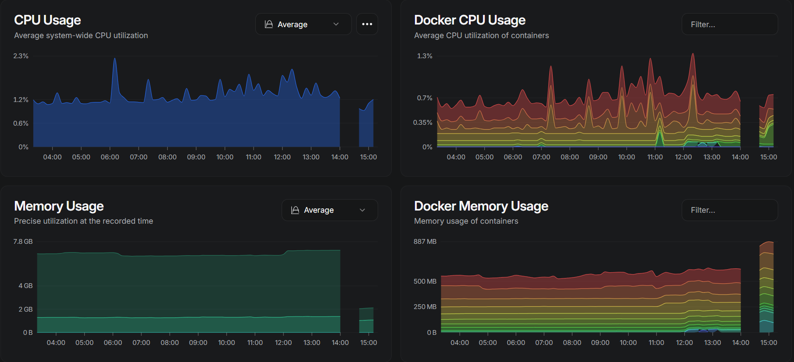

# Why I Swapped Grafana and Prometheus for Beszel (For Now)

I love the Grafana and Prometheus stack. It's what helped me figure out my builds were crashing my VPS in the first place (I wrote about that in [Offloading Docker Builds with GHCR](/blog/offloading-docker-builds)), and being able to see the state of all my resources in one place was a big deal for me.

But I've decided to part ways with it on my server. At least for now.

## The problem: it's heavy for my scale

Prometheus is especially heavy at my scale, and thats not me saying it's unreasonably heavy. It does a lot. It's built to scrape hundreds of targets, store long histories, and answer complicated queries across all of it, which is exactly why it's so popular.

My main VPS has under 4 GB of RAM. On that box I have Coolify, a reverse proxy, analytics, a handful of client sites with staging copies, and this portfolio. Every few hundred MB matters. Paying that much memory for a monitoring stack to watch a server that is mostly short on memory felt a bit backwards.

When I was honest with myself about what I actually looked at in Grafana, it was always the same few things:

- CPU and memory over the last day
- Which container is eating the RAM
- Is anything down or restarting
- Network in and out

That's it. I wasn't writing PromQL queries. I had one dashboard and I opened it when something felt slow.

## Beszel

[Beszel](https://beszel.dev) is a much lighter and simpler tool. There's a small hub with a web UI and an agent on the server that reports system and per-container stats. It covers everything on that list above, it has alerts, and it barely registers on the memory graph.

*One of my servers in Beszel. The Docker panels on the right are the per-container view I actually use.*

It's not as powerful. There's no query language and you can't build crazy custom dashboards. But I didn't need that, and I get the same level of observability I was actually using without giving up a chunk of the server.

A nice side effect: Beszel has a simple API, so the live stats panel at the top of my homepage now comes straight from it. A server-side route logs in with a read-only user and only passes through a few whitelisted numbers, so the browser never talks to the monitoring hub directly.

## A small gotcha

The first time I showed per-container memory on the homepage, the list was full of names like `k4s8...-142233`. Coolify names containers after its own internal IDs, so the raw list was meaningless to anyone reading it. Worse, some of the readable ones were client project names that I didn't really want on a public page.

So the route maps container names to a short allowlist of labels (Coolify, Monitoring, This site and so on) and lumps everything else into "Other". Lesson learned: just because the data is already there doesnt mean all of it should be public.

## Pick the tool for your situation

I think this shows something I keep running into. It's easy to gravitate to the popular tool because it's what everyone uses, and what job ads list. Prometheus is absolutely worth learning, and I'm still using it in places where it makes sense (anything Kubernetes shaped, for example).

But "industry standard" and "right for a single small server" aren't the same question. It's worth researching what fits what you're actually running, not what you might be running one day.

If I outgrow it, Prometheus will probably come back. Until then, Beszel it is.
