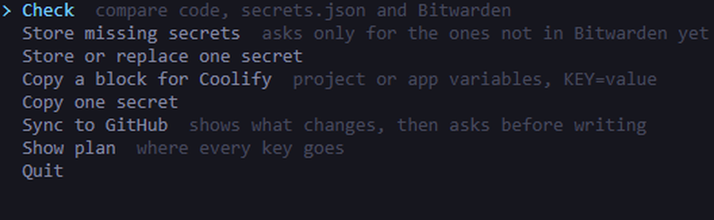

# keys

Switching between projects with different key requirements, I always forgot what was needed, and sometimes why. Now I rely on a single JSON file per repo, `secrets.json`, which tells me which keys the project needs and where each one goes: GitHub, Coolify, build time or runtime. It only holds names, never values, so it's safe to commit.

The `keys` CLI reads that file and connects to my **Bitwarden** account. Bitwarden is an open-source password manager: everything in the vault is encrypted on my device before it's stored, and it has a command line tool (`bw`) that scripts can use. That's where the actual secret values are saved for later, one folder per client.

From there I can:

- **Copy a block** of `KEY=value` lines for a Coolify project or app and paste it straight in. The clipboard clears itself after 30 seconds.
- **Sync to GitHub** using the `gh` CLI, with a dry run first that shows what would change.
- **Check** a repo: what the code reads, what `secrets.json` says, what the workflows expect and what's in Bitwarden.

## Making Bitwarden fast enough

During testing I realised it took insanely long to work with Bitwarden. Every `bw` call costs about a second, and the first version made one call per secret, plus a vault sync on every run. Checking one client could take longer than doing it by hand.

So I changed how it uses the CLI. It now reads a whole client folder in a single call and takes every value from that one listing, and it skips the vault sync if one already ran in the last five minutes.

## Rules it follows

- It never prints a secret value, anywhere.
- It refuses to copy a block while a public value is still a placeholder like `TODO`.
- It never deletes anything on GitHub.
- The tests use a fake `bw`, so they never touch a real vault.

## Next

I plan to connect it to Tower, my Coolify proxy, so `keys` can update variables in Coolify directly after authenticating, instead of me pasting blocks.

[Why I built it](/blog/managing-secrets-with-keys)
